<p align="center">
  <picture>
    <source media="(prefers-color-scheme: dark)" srcset="strata/strata-dark.svg">
    
  </picture>
</p>

<h1 align="center">Strata</h1>

<p align="center"><b>Your code, laid down like rock.</b></p>

Every night, Strata reads your public GitHub activity and redraws it as a slice of earth.

- **Each month is a layer.** Busy months are thick, quiet months are thin.
- **Colour comes from your language.** The language you committed most that month tints the rock.
- **Eras get names.** Stretches of the same language become periods: *The Pythonian*, *The Rustocene*, *The Typassic*…
- **Fossils mark beginnings.** Every new repository leaves a small ammonite in its month.
- **The surface is alive.** Grass grows with your current streak, and a pulse marks today.

It is one dependency-free Node script that outputs two animated SVGs (light and dark), so it looks right on any GitHub theme.

## Add it to your profile

**1. Add the workflow** to your profile repo (`<you>/<you>`) at `.github/workflows/strata.yml`:

```yaml
name: Strata

on:
  schedule:
    - cron: '0 0 * * *'   # every night
  workflow_dispatch:

permissions:
  contents: write

jobs:
  strata:
    runs-on: ubuntu-latest
    steps:
      - uses: actions/checkout@v4
      - uses: AnitaGeorge404/strata@v1
```

**2. Run it once:** go to **Actions → Strata → Run workflow**. It commits `strata/strata-dark.svg` and `strata/strata-light.svg`.

**3. Show it** in your profile `README.md`:

```html
<picture>
  <source media="(prefers-color-scheme: dark)" srcset="strata/strata-dark.svg">
  
</picture>
```

That's it. A new layer is deposited every night.

## Options

| Input          | Default                      | What it does                                                                              |
| -------------- | ---------------------------- | ----------------------------------------------------------------------------------------- |
| `github_user`  | repo owner                   | Whose activity to draw                                                                    |
| `github_token` | `github.token`               | Token for the GitHub API. Use a personal access token to count private contributions too |
| `months`       | `24`                         | How much history to show (6–36)                                                           |
| `output_dir`   | `strata`                     | Where the SVGs go                                                                         |
| `commit`       | `true`                       | Commit and push the result                                                                |

```yaml
      - uses: AnitaGeorge404/strata@v1
        with:
          months: 36
```

## Run it locally

Needs Node 20+. No `npm install`; there are no dependencies.

```bash
# preview with made-up data
node src/index.js --demo --out examples

# your real rock
GITHUB_TOKEN=$(gh auth token) node src/index.js --user <your-login>
```

## How it works

| File            | Job                                                                       |
| --------------- | ------------------------------------------------------------------------- |
| `src/github.js` | One GraphQL query per month: contribution total, commits per language, new repos, current streak |
| `src/eras.js`   | Picks each month's dominant language and groups months into named eras |
| `src/render.js` | Stacks layers (thickness ∝ √contributions), folds them with seeded noise so every profile's rock is unique, then adds fossils, grass and animation |

The folds are seeded from your username, so your rock always keeps the same shape and only grows.

## License

MIT
